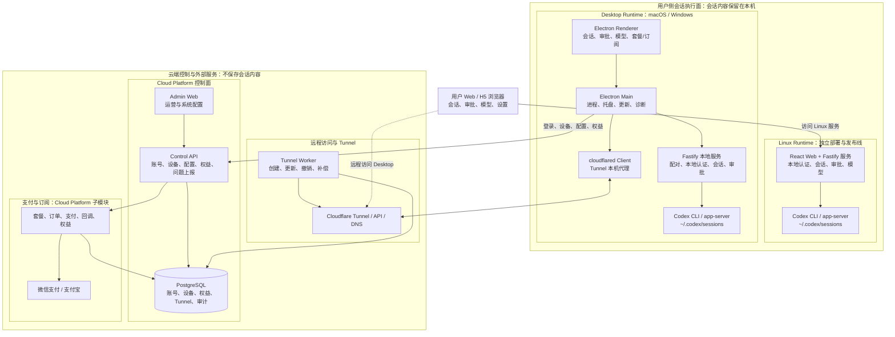

# Codex Manage

`main` 分支提供单体 Web 版本：一个 Fastify 服务托管 React 页面，并在同一台主机上启动宿主机的 `codex app-server`。安装器支持 Linux/systemd 和 macOS/launchd。它不包含桌面客户端、Cloudflare Tunnel、运营后台、支付或云端控制面。

## 产品全局架构与分支边界

下图描述的是产品全貌，不表示所有组件已经合入当前 `main`。`main` 是 Web Runtime（Linux/macOS）与 Web/H5 的稳定线；Desktop、Cloud Platform 及其支付、域名配置能力仍以各自的候选分支为实现来源，合并与发布必须经版本门禁确认。



Linux Runtime 与 Desktop Runtime 是并列的用户侧运行形态和独立发布线；Tunnel 是由桌面端 `cloudflared`、云端 Worker 与 Cloudflare 组成的跨端远程访问模块；Cloud Platform 只管理控制数据，不保存会话内容。支付与订阅是 Cloud Platform 的子模块，首版渠道为微信支付和支付宝。

| 实现来源 | 1.0.7 候选内容 | 进入联合发布前的条件 |
| --- | --- | --- |
| `origin/feature/f-20260728-pay` | 支付模块、Control API 支付链路、Desktop 套餐购买、运营后台支付管理 | 商户参数和回调联调、真实小额订单、幂等与权限验收；未完成前保持购买关闭 |
| `origin/feature/f-20260730-domain` | Desktop 运行时域名配置、Control API/Worker 动态系统配置、后台配置页、SMTP 验证码 | 新旧域名灰度、桌面配置刷新、迁移/回滚、SMTP 发送与安全验收 |
| `origin/feature/f-20260804-ui` | Web/H5 会话工作台视觉与交互重构 | UI/UX 审计、关键任务流与移动端可用性回归、无障碍和视觉验收 |

Desktop 与 Cloud Platform 的 `v1.0.6` 已由项目负责人确认同期发布；两条发布线仍分别保存版本、构建物、环境验收与回滚证据。详见 [`docs/releases/README.md`](docs/releases/README.md) 和 [`docs/governance/`](docs/governance/)。

推荐部署方式是：GitHub Actions 构建无源码运行包，Linux 服务器用同一个系统用户通过 systemd 启动。不要用 Docker 做主部署。

## 本地外网试用

外网入口不要直接转发 Vite 开发服务：开发模式包含 React 开发运行时、热更新和多个源码模块，高延迟网络会显著放大首屏等待。

本地开发仍使用 `npm run dev`。通过现有外网隧道展示和试用时，先停止开发服务，再运行：

```bash
npm run local:public
```

该命令构建前端，在 4310 提供构建后的页面，并将 API 和 WebSocket 转发到 4311 的本地后端；原有隧道目标端口不变。前端修改后需要重新执行构建。已有后端运行时，也可以单独执行 `npm run build:client` 后运行 `npm run serve:client`，保留后端进程。

这是本地试用入口。正式部署继续使用下方的单体运行包与 `npm start`。

## 构建运行包

GitHub Actions 工作流：`.github/workflows/build-runtime-package.yml`。

触发方式：

- 从已验证的 `main` 创建并推送 `release/vX.Y.Z` 分支，例如 `release/v1.0.9`。
- 流水线运行测试、生产构建，并生成运行包、SHA-256 和包含源码提交的 `build-info.txt`。
- 先创建草稿 Release，下载其中的实际包，在 Ubuntu 24.04/systemd 上验证安装、登录、静态资源、升级、回滚和服务启停；通过后发布 Release 和官网。
- 发布后再次下载并核对文件，创建 `runtime/vX.Y.Z` annotated tag，并保存验收报告。失败的安装验收不会自动转为正式发布。

推送触发时，运行包在 GitHub Actions run 页面底部的 Artifacts 区域下载，名称类似：

```text
codex-manage-runtime-1.0.9-<12位commit>
```

正式运行包上传到对应的 GitHub Release：

```text
https://github.com/foxhello-ai/codex-manage/releases/tag/v1.0.9
```

Release asset 固定命名为：

```text
codex-manage-runtime.tgz
codex-manage-runtime.tgz.sha256
install-runtime.sh
runtime-installation-verification.json
```

Release 版本号不可静默覆盖；已存在时 workflow 会失败。修复已发布版本应使用新版本号。

有仓库权限时可通过 GitHub CLI 下载实际安装文件，再上传到 Linux 服务器。私有仓库不支持匿名下载：

```bash
gh release download v1.0.9 --repo foxhello-ai/codex-manage \
  --pattern 'codex-manage-runtime.tgz*' --pattern install-runtime.sh
```

运行包内容：

```text
dist/
node_modules/ production dependencies
package.json
package-lock.json
build-info.txt
```

运行包不包含本仓库的 `.git`、`src`、测试文件、文档目录和 sourcemap。`node_modules` 来自 npm 生产依赖，按依赖包自身发布内容进入运行包。注意：前端和服务端会被打包成 JavaScript，运行包使用方仍然可以查看构建后的 JS，因此这不是代码加密方案。

查看构建来源：

```bash
cat /opt/codex-manage/current/build-info.txt
```

## 服务器前置条件

在 Linux 服务器上准备一个专用用户，例如 `deploy`。这个用户必须同时满足：

- 已安装并登录 `codex`。
- 能访问 `~/.codex/sessions`。
- 能访问需要继续处理的项目目录。
- 拥有项目所需工具链，例如 `git`、`node`、`npm`、`mvn`、`ssh`、私有脚本等。

关键点：systemd 服务必须用这个同一个 Linux 用户启动。这样已有会话里的绝对路径、宿主机工具链、SSH key、MCP 配置和未来新建目录都能按宿主机真实环境工作。

`install-runtime.sh` 的 `--user` 可以省略：

- 用普通用户执行 `sudo bash install-runtime.sh ...` 时，默认使用发起 sudo 的用户。
- 已经在 root shell 中执行 `bash install-runtime.sh ...` 时，默认使用 `root`。
- 如果 Codex 会话属于其他用户，必须显式传 `--user <用户名>`。

示例：

```bash
sudo useradd -m -s /bin/bash deploy
sudo -iu deploy
codex login
codex doctor
```

如果已有 Codex 会话本来就是 `deploy` 用户创建的，不需要迁移会话目录。如果已有会话属于另一个用户，应当用那个用户运行服务，或者为不同用户分别部署独立实例。

## macOS 安装（MacBook Air / Pro）

`v1.0.9` Release 附带的旧安装脚本仅支持 Linux。macOS 请使用 `main` 上更新后的安装器，它安装相同的 Web Runtime，并用当前用户的 launchd LaunchAgent 管理服务。这不是 `.app` 桌面安装包。

先准备 Node.js 22+，并在同一个 macOS 用户下安装、登录 Codex CLI；安装器也能识别 `/Applications` 下官方桌面应用附带的 CLI。打开该用户的桌面终端执行，**不使用 `sudo`，不传 `--user deploy`**：

```bash
curl -fsSL https://raw.githubusercontent.com/foxhello-ai/codex-manage/main/scripts/install-runtime.sh \
  | bash -s -- --version 1.0.9
```

安装完成后打开 `http://127.0.0.1:4310`。访问密码保存在当前用户配置文件中，可用以下命令查看：

```bash
sed -n 's/^CODEX_WEB_PASSWORD=//p' "$HOME/Library/Application Support/Codex Manage/runtime.env"
```

默认目录是 `~/Library/Application Support/Codex Manage`，包含 `current`、`releases`、`data`、`logs` 和 `runtime.env`。服务配置为 `~/Library/LaunchAgents/ai.foxhello.codex-manage.plist`。安装器保存 Node 与 CLI 的绝对路径、当前工具链 PATH，并生成独立的访问密码；官方桌面应用无需修改。升级时保留已有配置与数据，可通过同一命令重新安装或指定其他版本。

```bash
# 重启
launchctl kickstart -k "gui/$(id -u)/ai.foxhello.codex-manage"
# 停止（本次登录期间停止；下次登录仍会自动启动）
launchctl bootout "gui/$(id -u)/ai.foxhello.codex-manage"
# 再次启动
launchctl bootstrap "gui/$(id -u)" "$HOME/Library/LaunchAgents/ai.foxhello.codex-manage.plist"
```

服务在当前用户登录后自动运行，退出登录后停止；Mac 休眠时无法提供持续远程访问。默认只监听本机。需要局域网访问时可在首次安装增加 `--host 0.0.0.0`；已有配置需修改 `runtime.env` 后重启。Windows 的本机服务安装暂不支持。

## Linux 一条命令安装

服务器上已有 `deploy` 用户并已用该用户登录 Codex 时，可以直接执行。公开仓库使用：

```bash
curl -fsSL https://raw.githubusercontent.com/foxhello-ai/codex-manage/main/scripts/install-runtime.sh \
  | sudo bash -s -- --user deploy --version 1.0.9
```

私有仓库不能匿名访问 `raw.githubusercontent.com`，GitHub 会返回 404。如果不想在服务器配置 GitHub token，先在本地或 CI 页面下载运行包，再把运行包和安装脚本上传到服务器。

从 GitHub Actions Artifacts 下载到本地时通常是 `.zip`，可以直接传给 `--package`：

```bash
scp scripts/install-runtime.sh \
  codex-manage-runtime-1.0.9-<12位commit>.zip \
  deploy@server:/tmp/

ssh deploy@server
sudo bash /tmp/install-runtime.sh \
  --user deploy \
  --package /tmp/codex-manage-runtime-1.0.9-<12位commit>.zip
```

如果当前登录服务器的用户就是已登录 Codex 的用户，可以省略 `--user`：

```bash
sudo bash /tmp/install-runtime.sh \
  --package /tmp/codex-manage-runtime-1.0.9-<12位commit>.zip
```

如果手里是 Release asset 里的 `codex-manage-runtime.tgz`，也可以上传 tgz 和同名 `.sha256` 后安装。`--user deploy` 里的 `deploy` 必须替换成真实存在、且已经登录 Codex 的 Linux 用户。

安装脚本会：

- 从 GitHub Release 下载 `codex-manage-runtime.tgz`，或使用 `--package` 指定的本地 `.tgz` / Actions artifact `.zip`。
- 下载并校验 `codex-manage-runtime.tgz.sha256`；本地 tgz 模式会自动使用同路径的 `.sha256` 文件，artifact zip 模式会使用 zip 内的 `.sha256` 文件。
- 安装到 `/opt/codex-manage/releases/<version>-<commit>`。
- 切换 `/opt/codex-manage/current`。
- 首次安装时生成 `/etc/codex-manage/codex-manage.env`。
- 在 `/opt/codex-manage/` 下创建 `env`、`service`、`build-info.txt` 运维入口链接。
- 创建并启动 `codex-manage.service`。

如果只想安装文件和 systemd unit，但暂不启动服务：

```bash
curl -fsSL https://raw.githubusercontent.com/foxhello-ai/codex-manage/main/scripts/install-runtime.sh \
  | sudo bash -s -- --user deploy --version 1.0.9 --no-start
```

本地包模式：

```bash
sudo bash /tmp/install-runtime.sh \
  --user deploy \
  --package /tmp/codex-manage-runtime-1.0.9-<12位commit>.zip \
  --no-start
```

安装最新 Release：

```bash
curl -fsSL https://raw.githubusercontent.com/foxhello-ai/codex-manage/main/scripts/install-runtime.sh \
  | sudo bash -s -- --user deploy
```

执行远程脚本前，生产环境建议先打开脚本审阅。公开仓库：

```bash
curl -fsSL https://raw.githubusercontent.com/foxhello-ai/codex-manage/main/scripts/install-runtime.sh
```

私有仓库直接审阅上传到服务器的脚本：

```bash
less /tmp/install-runtime.sh
```

## 运维入口

安装后所有常用入口都可以从 `/opt/codex-manage` 找到：

```text
/opt/codex-manage/
  current -> /opt/codex-manage/releases/<version>-<commit>
  releases/
  env -> /etc/codex-manage/codex-manage.env
  service -> /etc/systemd/system/codex-manage.service
  build-info.txt -> /opt/codex-manage/current/build-info.txt
```

路径设计是有意分开的：

- `/opt/codex-manage` 放应用运行包和版本切换入口。
- `/etc/codex-manage/codex-manage.env` 放机器级配置和密钥，root 管理，权限更收敛。
- `/etc/systemd/system/codex-manage.service` 放 systemd unit，符合 Linux 服务管理习惯。
- `/opt/codex-manage/env` 和 `/opt/codex-manage/service` 是查找入口，方便运维从安装目录反查配置和服务文件。

常用检查命令：

```bash
ls -l /opt/codex-manage
cat /opt/codex-manage/build-info.txt
sudo systemctl cat codex-manage
sudo systemctl status codex-manage
sudo systemctl restart codex-manage
sudo journalctl -u codex-manage -f
sudoedit /etc/codex-manage/codex-manage.env
```

修改 `/etc/codex-manage/codex-manage.env` 后，执行 `sudo systemctl restart codex-manage` 让配置生效。

## 手动安装运行包

推荐使用安装脚本的本地包模式。将 Actions artifact zip 和安装脚本上传到服务器：

```bash
scp scripts/install-runtime.sh \
  codex-manage-runtime-1.0.9-<12位commit>.zip \
  deploy@server:/tmp/
```

然后在服务器上执行：

```bash
sudo bash /tmp/install-runtime.sh \
  --user deploy \
  --package /tmp/codex-manage-runtime-1.0.9-<12位commit>.zip
```

如果当前用户就是 Codex 用户，可以省略 `--user`。

如果手里是 Release asset 的 `codex-manage-runtime.tgz`，也可以传 `--package /tmp/codex-manage-runtime.tgz`。如果不使用安装脚本，也可以手动安装到版本目录：

```bash
sudo mkdir -p /opt/codex-manage/releases
sudo mkdir -p /home/deploy/.codex-manage

release="1.0.9-<12位commit>"
sudo mkdir -p "/opt/codex-manage/releases/$release"
sudo tar -xzf "/tmp/codex-manage-runtime.tgz" \
  -C "/opt/codex-manage/releases/$release" \
  --strip-components=1

sudo chown -R deploy:deploy /opt/codex-manage /home/deploy/.codex-manage
sudo ln -sfn "/opt/codex-manage/releases/$release" /opt/codex-manage/current
sudo ln -sfn /opt/codex-manage/current/build-info.txt /opt/codex-manage/build-info.txt
```

## 配置环境变量

创建 `/etc/codex-manage/codex-manage.env`：

```bash
sudo mkdir -p /etc/codex-manage
sudo tee /etc/codex-manage/codex-manage.env >/dev/null <<'EOF'
NODE_ENV=production
CODEX_WEB_HOST=127.0.0.1
CODEX_WEB_PORT=4310
CODEX_WEB_PASSWORD=replace-with-strong-password
CODEX_WEB_SESSION_SECRET=replace-with-long-random-secret
CODEX_CLI_PATH=/usr/local/bin/codex
CODEX_SESSIONS_DIR=/home/deploy/.codex/sessions
CODEX_MANAGE_METADATA_FILE=/home/deploy/.codex-manage/session-metadata.json
EOF

sudo chmod 600 /etc/codex-manage/codex-manage.env
sudo ln -sfn /etc/codex-manage/codex-manage.env /opt/codex-manage/env
```

按服务器实际安装位置调整 `CODEX_CLI_PATH`：

```bash
sudo -iu deploy command -v codex
```

生产环境必须修改 `CODEX_WEB_PASSWORD` 和 `CODEX_WEB_SESSION_SECRET`。

## systemd 服务

创建 `/etc/systemd/system/codex-manage.service`：

```ini
[Unit]
Description=Codex Manage Web
After=network.target

[Service]
Type=simple
User=deploy
Group=deploy
WorkingDirectory=/opt/codex-manage/current
Environment=HOME=/home/deploy
EnvironmentFile=/etc/codex-manage/codex-manage.env
ExecStart=/usr/bin/node dist/server/index.js
Restart=always
RestartSec=3

[Install]
WantedBy=multi-user.target
```

创建服务文件查找入口：

```bash
sudo ln -sfn /etc/systemd/system/codex-manage.service /opt/codex-manage/service
```

启动：

```bash
sudo systemctl daemon-reload
sudo systemctl enable --now codex-manage
sudo systemctl status codex-manage
```

日志：

```bash
journalctl -u codex-manage -f
```

健康检查：

```bash
curl http://127.0.0.1:4310/api/health
```

## 反向代理

建议只让服务监听 `127.0.0.1:4310`，公网入口交给 Nginx、Caddy 或云负载均衡处理 HTTPS。

Nginx 示例：

```nginx
server {
    listen 80;
    server_name codex.example.com;

    location / {
        proxy_pass http://127.0.0.1:4310;
        proxy_http_version 1.1;
        proxy_set_header Host $host;
        proxy_set_header X-Real-IP $remote_addr;
        proxy_set_header X-Forwarded-For $proxy_add_x_forwarded_for;
        proxy_set_header X-Forwarded-Proto $scheme;
        proxy_set_header Upgrade $http_upgrade;
        proxy_set_header Connection "upgrade";
    }
}
```

访问：

```text
https://codex.example.com
```

## 升级

可以重新执行安装脚本升级到指定版本：

```bash
curl -fsSL https://raw.githubusercontent.com/foxhello-ai/codex-manage/main/scripts/install-runtime.sh \
  | sudo bash -s -- --user deploy --version 1.0.9
```

私有仓库或离线服务器可以上传新运行包后升级：

```bash
sudo bash /tmp/install-runtime.sh \
  --user deploy \
  --package /tmp/codex-manage-runtime-1.0.9-<12位commit>.zip
```

也可以手动上传新 tarball 后安装到新版本目录，然后切换 `current`：

```bash
release="1.0.9-<新的12位commit>"
sudo mkdir -p "/opt/codex-manage/releases/$release"
sudo tar -xzf "/tmp/codex-manage-runtime.tgz" \
  -C "/opt/codex-manage/releases/$release" \
  --strip-components=1
sudo chown -R deploy:deploy "/opt/codex-manage/releases/$release"
sudo ln -sfn "/opt/codex-manage/releases/$release" /opt/codex-manage/current
sudo systemctl restart codex-manage
```

回滚到旧版本：

```bash
sudo ln -sfn /opt/codex-manage/releases/<旧版本目录> /opt/codex-manage/current
sudo systemctl restart codex-manage
```

## 为什么不用 Docker 做主部署

Codex Manage 要接管宿主机真实 Codex 会话，而会话依赖宿主机绝对路径、用户权限、工具链、SSH key、MCP 配置和未来新建目录。Docker 方案需要不断挂载这些路径，最终会变成复杂且脆弱的半隔离环境。

systemd 方案直接以同一个 Linux 用户运行，能天然读取已有会话，也能处理未来新目录；同时服务器只部署无源码运行包，不需要 `git clone` 仓库。

## 常用环境变量

| 变量 | 默认值 | 说明 |
| --- | --- | --- |
| `CODEX_WEB_HOST` | `0.0.0.0` | Web 服务监听地址 |
| `CODEX_WEB_PORT` | `4310` | Web 服务端口 |
| `CODEX_WEB_PASSWORD` | `admin` | 登录密码，生产环境必须覆盖 |
| `CODEX_WEB_SESSION_SECRET` | 随机值 | Cookie 签名密钥，生产环境必须固定 |
| `CODEX_CLI_PATH` | macOS 优先使用 ChatGPT 内置 CLI，否则为 `codex` | 宿主机 Codex CLI 路径；显式设置后覆盖默认路径 |
| `CODEX_EXPECTED_CLI_VERSION` | 未设置 | 启动或重载时校验 Codex CLI 版本，例如 `0.149.0` |
| `CODEX_SESSIONS_DIR` | `~/.codex/sessions` | Codex 会话目录 |
| `CODEX_MANAGE_METADATA_FILE` | `.codex-manage/session-metadata.json` | Codex Manage 会话元数据 |

## 生产建议

- 不要在生产机 `git clone` 仓库；只上传运行包。
- systemd `User` 必须是实际使用 Codex 的 Linux 用户。
- 不要使用默认密码 `admin`。
- 不要把 `/etc/codex-manage/codex-manage.env` 放宽到普通用户可读。
- 用 HTTPS 暴露服务，不要直接公网裸露 `4310`。
- 升级前先查看 `build-info.txt`，确认运行包来自预期 commit。
