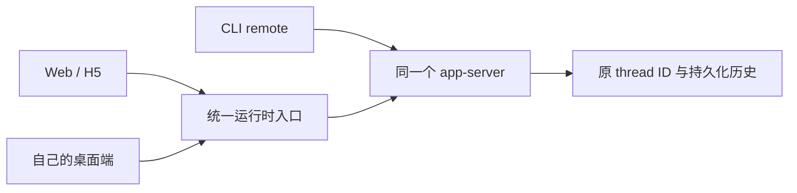

# 技术预研：持锁会话的连续接续

日期：2026-10-30（Asia/Shanghai）。研究基线：当前 `main`、本机 CLI 与官方 OpenAI 文档。本次交付研究文档、隔离实验脚本和结果，不修改产品运行逻辑。

建议分两步：近期使用**原生 Fork 继承历史，并把恢复链呈现为同一个逻辑会话**；长期让可控的客户端**共用持有原 thread 的 app-server**，继续原 thread ID。

同日后续的独立验证项 [SRF-01](2026-10-30-shared-runtime-feasibility.md) 已验证本机官方桌面可以在启动时接入外部共享服务，并验证实际 Manage 双端同步及其缺口。本报告原有 48 项断言仍只代表两个 CLI 版本的协议实验，不应与官方桌面验证混算；已经通过私有 stdio 启动的真实桌面服务仍未建立热附着入口。

## 说明原因

### 已确认的锁行为

本项目讨论的是 ChatGPT 桌面中的本地 Work/Codex 执行会话及其 `~/.codex/sessions` 数据。普通 Chat 网页聊天的 ID 不属于本项目的 `thread/resume` 数据源。

`active writer` 表示原 app-server 仍持有 thread 的写入所有权。一次生成结束后，服务仍可保留该 thread，因此“已经停止回答”和“其他进程能够恢复”不是同一个状态。

本次分别用 `codex-cli 0.163.0` 与桌面内置 `0.162.0-alpha.2`，在独立临时数据目录启动两个 app-server，并覆盖 `legacy`、`paginated` 两种历史格式。结果一致：

| 实验 | 结果 | 结论 |
| --- | --- | --- |
| A 创建并完成一轮，A 的第二个连接 resume | 成功，ID 不变 | 同一服务的多个连接可以接回原 thread |
| B 读取 A 持有的 thread | 成功 | 查看历史不要求取得写入权 |
| B resume A 持有的 thread | `already has an active writer` | 独立进程直接争取同一 thread 的写入权会冲突 |
| B 原生 Fork A 持有的、已结束生成的 thread | 成功，产生新 ID | 本次验证版本可在原 thread 持锁时原生 Fork |
| B 在 Fork 中发下一条消息 | 请求包含原用户消息、原回复和新消息 | 原生 Fork 能继承已保存对话，无需让模型重新找日志 |
| A 的两个连接都 unsubscribe，B 立即 resume | 仍然持锁 | unsubscribe 不等于立即卸载或移交 |
| 结束实验用的 A 进程，B resume 原 thread | 成功，ID 不变 | 原 writer 退出后，可以恢复原会话 |

这修正了 [2026-09-02 笔记](2026-09-02-writer-lock-history-continuation.md) 中“持锁时 Fork 也不可用”的笼统表述。该旧记录不能继续作为所有版本的能力判断。这里没有证明最早支持版本，也没有覆盖源会话正在执行工具、等待审批或生成中的场景。

官方文档说明：最后一个订阅者退出后，服务在无订阅且无 thread 活动 **30 分钟**后才卸载 thread。本次只验证了立即重试仍失败，没有等待 30 分钟。该时间来自文档，不能由项目的短暂重试替代。

### 当前桌面进程的接入边界

本机桌面内置 CLI 位于 `/Applications/ChatGPT.app/Contents/Resources/codex-cli/bin/codex`，版本为 `0.162.0-alpha.2`；PATH 中的 CLI 为 `0.163.0`。两者均提供 `app-server proxy --sock` 命令。

对当前桌面 app-server 的只读检查显示：启动参数没有 `--listen`，没有发现可供本项目连接的 app-server listener；默认 daemon control socket 也不存在。因此，**共享服务的协议路径已验证，直接附着当前已启动桌面进程的入口尚未建立**。桌面的 `ipc.sock` 不能直接当作公开 app-server socket 使用。

官方 Remote Control 提供另一条使用路径：在具备该功能、主机在线且完成配对的情况下，通过官方客户端访问原主机的 chats 和运行环境。这适合立即跨设备继续工作，但不是本项目已有的接入实现。

## 当前代码问题点

1. `CodexAppServerClient.start()` 固定启动新的 `codex app-server`。复用同一个可执行文件、用户目录或会话文件，不会让它自动成为桌面正在使用的那个进程。
2. active writer 错误界面的主要恢复入口是 `continue-from-history`，直接创建空白 thread，再让模型查找 JSONL、提取背景。它绕过了锁，但把上下文重建变成新的工具工作。
3. 前端跳转新的原生 thread，并追加“历史续聊（新会话）”标题。项目没有专门表达“同一会话的恢复链”的数据结构，所以用户同时感受到列表重复、历史断开与重复理解。
4. 现有短重试只有在对方恰好释放锁时才有效，没有所有权移交能力。后端还把所有 writer 冲突都写成“ChatGPT 正在占用”，无法准确描述 CLI 或其他客户端。
5. 原生 Fork 已有独立 API，但恢复策略仍沿用旧能力判断；后续应按实际运行版本和错误结果决定可用路径。

现有历史读取方案仍有价值，应作为兼容兜底。现有 `SessionService` 有意保留共享 `sessionId` 的不同 Fork，不能为了去重直接按 `sessionId` 合并所有原生分支，否则会隐藏用户主动创建的不同话题。

## 代码错误位置

下列位置体现当前架构或恢复体验的限制；本次没有修改这些产品代码。

| 位置 | 当前行为 | 后续调整方向 |
| --- | --- | --- |
| `src/server/services/CodexAppServerClient.ts:84` | `start()` 固定 spawn 独立服务 | 增加附着共享服务的连接模式 |
| `src/server/services/RuntimeManager.ts:178` | resume 本服务未加载的 thread，争取 writer | 区分附着原服务、可恢复、外部持锁三种情况 |
| `src/server/services/RuntimeManager.ts:387`、`:988` | 空白 thread + 模型读取 JSONL 的提示词 | 将上下文重建置于原生接续之后 |
| `src/server/services/RuntimeManager.ts:461`、`:518` | 显式 Fork 与短暂 writer 重试 | 复用原生 Fork，增加独立恢复事务与结果对账 |
| `src/server/routes/sessions.ts:543`、`:874` | 历史续聊路由及固定 ChatGPT 占用提示 | 提供统一接续决策，准确描述已知持锁信息 |
| `src/client/App.tsx:1327`、`:2939` | 恢复后切换新 thread，错误卡片要求新建会话 | 保持逻辑会话入口，展示一次接续状态 |
| `src/shared/models.ts:89`、`:112` | 会话与历史续聊返回结构均以原生 thread 为主 | 增加恢复关系、当前执行 thread 与接续边界 |
| `src/server/services/SessionMetadataStore.ts:55` | 保存标题、权限和模型偏好 | 持久化恢复关系，不能仅靠改标题关联 |
| `src/server/config.ts:8`、`:38` | 优先检查旧桌面二进制路径，否则使用 PATH | 诊断时显示实际路径和版本；本次不顺带调整发现逻辑 |

## 修改方案

### 方案比较

| 路径 | 保留原 thread ID | 上下文接续 | 当前可行性 |
| --- | --- | --- | --- |
| 回到原客户端或官方 Remote Control | 是 | 由原运行时继续 | 官方客户端路径；功能和主机连接需满足条件 |
| 连接持有原 thread 的同一个 app-server | 是 | 原运行时直接接续 | 协议实验通过；SRF-01 另已验证当前官方桌面的内部启动入口，完整产品同步仍有缺口 |
| 原 writer 释放后 resume | 是 | 从原持久化历史恢复 | 已验证；需要原拥有者配合，不能靠无限重试 |
| 原生 Fork + 同一逻辑会话入口 | 否 | 原生继承已保存历史 | 两个测试版本、两种格式均通过；推荐近期落地方向 |
| 空白 thread + 检查点/相关历史 | 否 | 重建必要背景 | 兼容兜底；必须保留已完成事项，减少重复工作 |

### 近期：原生 Fork 接续，并消除重复体验

建议恢复策略为：能接入原运行时则接回原 thread；独立服务 resume 明确被 writer 拒绝时，在适用版本上尝试原生 Fork；原生路径不支持时，才使用历史重建。

原生 Fork 路径使用 `thread/fork { threadId, excludeTurns: true }`，随后向子 thread 发送用户尚未被接收的那条输入。继承的是已保存历史，不恢复正在运行的进程、未完成工具、待处理审批或原客户端的所有运行状态。

恢复界面和数据需一并设计：

- 增加应用级 `conversationId`、`activeThreadId`、`previousThreadId`、接续方式和切换历史边界。它们表示恢复关系，不篡改 Codex 的原生 ID。
- 一条恢复链在侧栏保留一个主要入口，正文显示一次“已接续”；原生 thread 的来源和编号放入可展开详情。用户主动创建的分支仍独立显示。
- 原生 Fork 已包含祖先历史，正文直接使用当前分支的历史视图，避免再拼接一遍完整父历史。历史重建模式才需要展示源历史与接续后的增量。
- 接续成功后，后续输入固定发往 `activeThreadId`。不要每次从旧入口发送都重新创建分支。
- 使用持久化的恢复请求 ID 和逻辑消息 ID，记录创建、发送和确认阶段。明确的 writer 拒绝可转接；发送超时、响应丢失等接收状态不明的情况，必须先对账，防止同一个任务执行两次。
- 保留目标、已完成工作、文件状态、测试结果和未完成事项的检查点。提示词要求从下一项继续，先核对变化，再决定哪些操作需要重做。

**执行中的源会话必须单独处理。**“持有 writer”与“正在执行”是两个维度。本次 Fork 实验只覆盖已完成回合后的持锁状态。若原客户端仍在修改同一 workspace，应先协调停止或等待；拿不到可靠活动状态时不能承诺无冲突自动切换。源客户端在切换后又继续产生消息时，也应明确提示出现分叉，而不能静默合并。

### 长期：统一会话运行服务

可控的 Web/H5、自己的桌面端和 CLI 共用一个 app-server，服务持有原生 thread，界面只是连接与显示层。



最小技术路径可以先使用 stdio JSON-RPC 与官方 Unix socket / WebSocket 之间的传输适配器。`codex app-server proxy --sock` 另涉及 daemon control socket，不能把它直接指向任意普通 Unix WebSocket listener；SRF-01 的前置实验中，这种接法初始化超时，最终使用明确的 WS ↔ stdio 转发。CLI 的 `--remote` 也提供共享服务连接路径，其与桌面 daemon 的具体组合需分别验收。

需要同步处理：外部服务的版本校验、连接重建、活动回合和审批状态恢复、每个 thread 的输入排序、事件对账，以及“拥有进程”与“仅连接服务”的生命周期区别。附着模式退出或刷新本项目时，应断开自己的连接，不能结束外部共享服务。现有 `resumeThread()` 固定写入 `waiting_input` 的行为，也需要根据真实活动回合恢复状态。

官方文档把 app-server / WebSocket 相关能力标为实验性，不能直接据此认定生产接入已经完成。尤其是第三方无法要求一个已经通过私有 stdio 启动的桌面进程新增公开 listener；桌面接入必须另行验证，不能把“启动自己的共享 daemon”当作“接管桌面现有进程”。

不采用 `thread/resume.history` 作为通用替代：本机生成类型将其标为 `[UNSTABLE] FOR CODEX CLOUD - DO NOT USE`。手工删除锁或改写历史里的 ID 也不能完成运行时所有权移交。

## 修改的代码点

### 本次实际交付

- 本研究报告，以及文档索引与旧笔记的结论范围说明。
- [`scripts/research/session-continuation-probe.mjs`](../../scripts/research/session-continuation-probe.mjs)：可复现的协议实验，使用临时数据目录和 localhost 模拟模型，不加载真实会话或调用真实推理服务。
- [`cli-0.163.0.json`](../acceptance/2026-10-30-session-continuation/cli-0.163.0.json) 与 [`bundled-0.162.0-alpha.2.json`](../acceptance/2026-10-30-session-continuation/bundled-0.162.0-alpha.2.json)：两个版本各 24 项断言的完整结果。

### 后续实施顺序

1. 增加“统一接续”服务与持久化恢复事务：先实现原生 Fork、失败输入保留和重复请求对账；保留历史重建兜底。
2. 增加逻辑会话恢复链与前端连续视图：同一入口继续，历史不重复拼接，真正的主动分支仍保留。
3. 加入共享 runtime 附着模式；官方桌面的接入与双端状态同步已单列 [SRF-01](2026-10-30-shared-runtime-feasibility.md) 完成实测，后续实施按该报告补齐产品缺口。

## 验证方式

复现环境：macOS，Node.js `v22.22.0`。脚本对每个 CLI 启动两个临时 app-server，A 有两个连接，B 有一个连接；模型回包由本机 HTTP stub 生成。每次运行共四次 localhost 模拟模型请求，无真实推理请求。

```bash
node scripts/research/session-continuation-probe.mjs

RESEARCH_CODEX_BIN=/Applications/ChatGPT.app/Contents/Resources/codex-cli/bin/codex \
  node scripts/research/session-continuation-probe.mjs
```

可通过 `RESEARCH_REPORT_PATH` 指定 JSON 结果文件，父目录需存在。脚本退出时结束它自己创建的进程，临时目录保留以便检查；失败断言使退出码非零。

两个版本各 24 项断言通过，包含预期的 writer 拒绝和原 ID 恢复验证。没有修改真实会话、停止桌面进程或改变运行配置。未运行与本次研究无关的产品测试套件。

仍需产品级验收：生成中/审批中转接、真实工具副作用、附件、长历史和压缩后历史、混用不同版本、原客户端晚到消息、重启恢复与失败发送对账。当前实验验证的是协议和已保存文本对话接续，不能证明模型在真实项目中完全不重复工作。

官方依据：

- [Codex App Server](https://learn.chatgpt.com/docs/app-server)：传输方式、resume/fork/read、unsubscribe 生命周期及历史分页。
- [Remote connections](https://learn.chatgpt.com/docs/remote-connections)：通过官方客户端访问原主机的项目、chats 和执行环境。

两页均已在本次研究中实际获取正文；本地 CLI 的 `--help`、生成协议类型和隔离实验用于核对本机版本行为。
