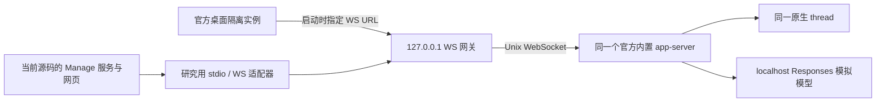

# SRF-01：官方桌面与 Codex Manage 共享服务可行性验证

日期：2026-10-30。独立验证项，承接[持锁会话接续研究](2026-10-30-session-continuation-research.md)。本项验证真实官方桌面接入、实际 Manage 双端同步和共享进程生命周期；没有把共享服务接入产品配置。

## 说明原因

**接入技术路径可行，当前产品的完整双端同步尚不满足交付条件。** 官方桌面可以在启动时连接指定的外部 app-server，Manage 通过研究用传输适配器连接同一服务，两端继续同一原生 thread，无须复制历史或 Fork。Manage 的配置监听、重新订阅、活动回合恢复和外部消息处理需要补齐。

这里的“官方桌面”具体是本机 `/Applications/ChatGPT.app`，版本 `26.1002.52244`、bundle ID `com.openai.codex`，验证对象为其本地 Work/Codex 会话。内置 CLI 为 `0.162.0-alpha.2`。普通 ChatGPT 云端聊天不在本次验证范围内；也没有证明其他桌面版本具备相同入口。

### 已确认的接入入口

只读检查安装包 `app.asar/.vite/build/application-network-startup-Bt0a8E1L.js`，发现启动参数读取：

```js
if (process.env.CODEX_APP_SERVER_FORCE_CLI === "1") return null;
const url = process.env.CODEX_APP_SERVER_WS_URL ?? hostConfig.websocket_url;
```

本次真实运行验证使用 `CODEX_APP_SERVER_WS_URL`。这是**本机安装版本的内部入口**，官方公开文档没有据此承诺其为稳定的第三方接入配置。

同一文件另有 `CODEX_APP_SERVER_USE_LOCAL_DAEMON=1` 分支，涉及默认 `app-server-control/app-server-control.sock`、版本及配置条件；本项没有把它算作已验收的第二条路径。

需区分两种目标：

| 目标 | 本次结论 |
| --- | --- |
| 预先启动共享 app-server，再让官方桌面与 Manage 都接入 | 实际接入成功，原 thread ID 不变 |
| 给已经通过私有 stdio 启动的现有桌面服务补 listener，并直接接管其原进程 | 未建立可用入口；本次没有证明可行 |

当前用户真实桌面和其 app-server 全程保持运行。实验另外启动官方应用的隔离实例；没有要求关闭用户桌面、搬迁真实会话或修改应用安装包。

### 验证拓扑



网关只转发帧和记录事件，不模拟 app-server 行为、不修复产品事件，也不注入桌面消息。Manage 使用当前源代码构建的 React 界面和原有后端；临时 `CODEX_CLI_PATH` 包装器仅把它原来的 stdin/stdout RPC 转接到共享服务。

`codex app-server proxy --sock` 不能直接等同于任意 `app-server --listen unix://...` listener：前置实验把普通 Unix WebSocket listener 传入该 proxy，初始化超时。最终验证使用明确的 WebSocket ↔ stdio 适配器。daemon control socket 与普通 listener 的兼容性需另验。

### 验收记录

机器可读结果见 [`results.json`](../acceptance/2026-10-30-shared-runtime/results.json)，协议摘要见 [`rpc-events.ndjson`](../acceptance/2026-10-30-shared-runtime/rpc-events.ndjson)。运行记录中的 `pass` 表示该条条件成立；`fail` 是实际复现的产品缺口；`blocked` 表示该条实验未完成，不能计作通过。

**本次最终结果：20 项，16 项通过、4 项未通过、0 项阻塞。** 四项未通过均为实际产品同步缺口。

| 验证条件 | 结果 | 观察 |
| --- | --- | --- |
| 官方桌面连接外部服务并完成初始化 | 通过 | 见结果项 `official-attach` |
| 官方桌面创建并完成持久化原会话回合 | 通过 | 见结果项 `official-original-thread` |
| 实际 Manage 接回桌面创建的同一 thread | 通过 | 见结果项 `manage-resume` |
| 共享目录下界面状态写入不应打断订阅 | 未通过 | generation 0 → 1，runtime 退回 history |
| Manage → 桌面：用户消息与回复自动出现 | 通过 | 见结果项 `manage-to-desktop` |
| 桌面 → Manage：完成回合后正文自动出现 | 通过 | 见结果项 `desktop-to-manage` |
| 交替输入后正文无重复消息 | 通过 | 见结果项 `no-visible-duplicates` |
| 桌面执行时 Manage 显示 running 与 activeTurnId | 通过 | 见结果项 `desktop-running` |
| 运行过程中 Manage 即时显示桌面用户消息 | 未通过 | 服务仍在 running，Manage 用户消息数为 0；完成后补出 |
| 桌面回合完成后两端回到空闲 | 通过 | 见结果项 `desktop-idle` |
| 桌面停止 Manage 发起的回合 | 通过 | 见结果项 `interrupt` |
| 协议客户端更新 effort，两端收到设置并显示 high | 通过 | 设置由第三个协议连接发起，验证两端接收；未验证所有设置的双向 UI 操作 |
| 生成中重新接入恢复真实 running 与 turn ID | 未通过 | HTTP 200，但返回 waiting_input、activeTurnId=null；服务实际回合正在执行 |
| 重新接入后接收完成事件与最新正文 | 通过 | 见结果项 `post-reconnect-events` |
| 真实命令审批同时送达桌面与 Manage | 通过 | 见结果项 `approval-fanout` |
| 桌面回答审批后 Manage 清除待审批 | 未通过 | 两端均收到 serverRequest/resolved，Manage 仍 pending=1、waiting_approval |
| 退出 Manage 不结束共享服务，桌面继续原会话 | 通过 | 见结果项 `manager-lifecycle` |
| 重启 Manage 接回原 ID 与最新历史 | 通过 | 见结果项 `manager-reconnect` |
| Manage 回答审批后两端清除待审批 | 通过 | Manage pending=0、waiting_input，桌面审批按钮消失 |
| 重启桌面后继续原 ID，Manage 同步新回合 | 通过 | 见结果项 `desktop-reconnect` |

本次持续使用原 thread `01a18b15-b535-7c42-8faf-57b017a5d2ce`。验证中没有调用 Fork 或历史复制接续。

截图：

- [双向续聊：官方桌面](../acceptance/2026-10-30-shared-runtime/bidirectional-desktop.png) / [Manage](../acceptance/2026-10-30-shared-runtime/bidirectional-manage.png)。
- [运行中：官方桌面](../acceptance/2026-10-30-shared-runtime/running-desktop.png) / [Manage](../acceptance/2026-10-30-shared-runtime/running-manage.png)。
- [桌面审批已完成](../acceptance/2026-10-30-shared-runtime/approval-resolved-desktop.png) / [Manage 仍卡待审批](../acceptance/2026-10-30-shared-runtime/approval-resolved-manage.png)。
- [Manage 审批后桌面清除请求](../acceptance/2026-10-30-shared-runtime/manage-approval-answer-desktop.png) / [Manage 正常空闲](../acceptance/2026-10-30-shared-runtime/manage-approval-answer-manage.png)。
- [桌面重连后继续原会话](../acceptance/2026-10-30-shared-runtime/desktop-reconnected-desktop.png) / [Manage 同步](../acceptance/2026-10-30-shared-runtime/desktop-reconnected-manage.png)。

关键观察：同目录配置监听造成的断连先在原始配置下复现；随后实验让 Manage 使用独立的配置监听目录，继续连接原共享服务及原 sessions 目录，以便单独验证其他同步能力。这是**实验隔离措施**，不是本次已交付的产品修复，也不能据此宣称原始部署已全面通过。

## 当前代码问题点

后续 [SRF-02：复用由官方桌面启动的后台](2026-11-03-desktop-owned-runtime-feasibility.md) 单独验证“由桌面创建服务，Manage 随后连接”，覆盖启动拥有关系与退出/重启，不改变本项的原始验收结果。

1. Manage 默认仍启动自己的 app-server，共用可执行文件或 `CODEX_HOME` 不会共用同一个进程。本次通过研究适配器建立连接，不代表产品已有附着模式。
2. 配置监听把根目录中所有 `.json` 文件都视作配置。桌面写入 `.codex-global-state.json` 会触发 Manage reload；连接重建后会话状态回到历史态，原订阅没有自动恢复。
3. `resumeThread()` 不读取返回 thread 的活动状态与正在进行的回合，结束时固定设置 `waiting_input`。生成中重新接入必须按真实 thread 快照恢复。
4. `item/started` 和 `item/completed` 只转发 `commandExecution`。另一端新增的 `userMessage` 没有对应实时事件，正文依靠回合结束后的历史刷新补全。
5. 审批记录保存在 Manage 本地；现有通知分发没有专门处理 `serverRequest/resolved`。实测桌面已批准、命令及回复已完成，服务也已向 Manage 发出解决通知，但 Manage 仍 pending=1 并禁用输入。反向由 Manage 批准时，两端均能清除请求，说明问题在 Manage 的外部解决事件处理。

## 代码错误位置

| 位置 | 当前限制 |
| --- | --- |
| `src/server/services/CodexAppServerClient.ts:93`、`:136` | 固定 spawn 自有 app-server；停止过程按拥有子进程处理 |
| `src/server/services/CodexConfigWatcher.ts:130` | 所有 `.json` 都触发配置变化，含桌面界面状态 |
| `src/server/services/AppRuntime.ts:70` | reload 的状态检查和停止/启动逻辑基于本地自有服务 |
| `src/server/services/RuntimeManager.ts:178`、`:247` | resume 后固定待输入，没有恢复活动回合 |
| `src/server/services/RuntimeManager.ts:770`、`:842` | 缺少跨连接审批已解决通知的专门处理 |
| `src/server/services/RuntimeManager.ts:847` | 非命令 item 被忽略，含外部客户端用户消息 |
| `src/server/services/ApprovalService.ts:79` | 本地提交才更新审批记录；缺少按服务通知清理/对账入口 |
| `src/client/App.tsx:772` | 实时显示与历史刷新依赖后端转换后的事件，需要补齐外部消息及重连对账 |

## 修改方案

把共享服务附着作为独立实现，完成以下条件后再进入产品验收：

1. 增加显式的 `owned` / `attached` 连接模式、endpoint 和服务版本诊断。附着模式只能断开自己的连接；服务由独立宿主管理。不要通过关闭真实桌面抢夺 writer。
2. 配置监听采用明确文件清单，排除桌面界面状态、索引与缓存；共享模式的配置生效应由服务拥有者处理，避免任一界面重启全局服务。
3. 连接重建后重新订阅原 thread，恢复活动 turn、正文快照与待审批，并对事件游标/消息 ID 去重。resume 应反映真实状态，不能把运行中会话标成空闲。
4. 转发、渲染外部 `userMessage` 与完整 item 生命周期。流式事件和历史刷新按原生 item ID 合并，避免重复显示或漏消息。
5. 按 `threadId + requestId` 对账 `serverRequest/resolved`；任何客户端回答后都要清理其他客户端的待审批。保留本次两种回答方向的回归，补测重复回答与审批中断连恢复。
6. 明确双端输入语义：空闲时新回合，运行中输入究竟是 steer 还是排队，需要产品约定及独立并发验收。不能仅因两端都能发送就承诺并行执行隔离。
7. 对官方桌面固定已验证版本与受控启动方式。内部环境变量发生变更时，应有可诊断的失败结果。现有私有 stdio 桌面实例的热附着仍是另外的研究问题。

本次没有把模拟文本验证外推为真实工程任务的“不重复执行”保证。工具副作用、文件变更、附件、长历史/压缩、模型供应商切换、账户共享、混合版本和远程访问鉴权仍需后续产品验收。

## 修改的代码点

本次新增的是研究脚本、独立验证报告、截图与结构化证据，以及相关文档链接。没有修改 `src/`，没有改变用户当前运行配置，没有提交或部署产品修改。

- [`scripts/research/shared-runtime-feasibility.mjs`](../../scripts/research/shared-runtime-feasibility.mjs)：启动真实官方桌面的独立实例、内置 app-server、localhost 模型、当前 Manage 与浏览器，逐项记录验收。
- [`docs/acceptance/2026-10-30-shared-runtime/`](../acceptance/2026-10-30-shared-runtime/)：本次运行结果、经过裁剪的协议日志及双端截图。
- 本报告作为研究项 `SRF-01` 单独跟踪，不混入既有原生 Fork 的 48 项协议断言，也不表示已创建产品需求或完成上线门禁。

## 验证方式

前提：macOS、上述官方桌面版本、仓库 npm 依赖和 Google Chrome。脚本默认使用安装包内置 CLI；Playwright 通过 CDP 控制官方桌面的**实验实例**，另开 headless Chrome 操作 Manage。

```bash
RESEARCH_REPORT_DIR=docs/acceptance/2026-10-30-shared-runtime \
  node scripts/research/shared-runtime-feasibility.mjs
```

可用 `RESEARCH_DESKTOP_APP` 指向其他安装包、`RESEARCH_BROWSER_CHANNEL` 指定已安装浏览器。不同版本的按钮或内部入口不兼容时，需按实际结果记录，不能沿用本次通过结论。

每次运行创建独立临时 `CODEX_HOME`、Electron profile、workspace、Manage 元数据和构建目录；为确保不会交给现有应用实例，使用 `CODEX_ELECTRON_USER_DATA_PATH` 及 `--user-data-dir`。认证是本地无效占位值，模型响应由 localhost SSE stub 产生；审批只使用无文件修改的 `printf SRF-...`。官方桌面自带的插件目录同步、遥测等后台请求可能仍尝试联网，但本次不调用真实模型，也不使用用户账户凭证。

脚本保留实验目录供排查，退出时清理它自己创建的服务和应用实例。结构化 `fail` 是完成的负向验收证据；脚本执行/前置条件发生致命错误时退出非零。`results.json` 的逐项结论是验收依据，退出零不表示产品全部通过。

官方依据：已获取 [Codex App Server](https://learn.chatgpt.com/docs/app-server) 与 [Remote connections](https://learn.chatgpt.com/docs/remote-connections) 正文。前者用于传输、订阅、回合、中断和审批通知语义；后者的官方远程功能不等于本报告所用内部启动 hook。公开文档和本机实验应分别标注来源。
