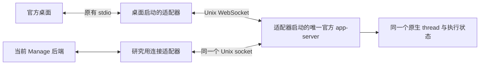

# SRF-02：复用由官方桌面启动的后台

日期：2026-11-03。承接 [SRF-01：外部共享服务接入](2026-10-30-shared-runtime-feasibility.md)。本项专门验证“先打开官方桌面，由桌面启动后台，Manage 随后连接”，不预先启动独立的 4500 服务。

## 说明原因

**后台复用的文本链路可行，但需要调整桌面的启动入口并加连接适配器。** 实测由官方桌面启动唯一的官方 app-server，当前 Manage 连接该后台后，两端能在同一个 thread 交替对话，继承已有上下文，无需复制历史、无需预先启动 4500 服务。默认图标启动的私有后台仍不能让 Manage 直接加入；本项未实现对已经运行的私有后台热接入。桌面重启后立即同步未通过，本轮主动输入后恢复；日志还出现桌面工具管道身份校验拒绝，因此尚不能作为完整产品方案直接交付。

本机官方桌面为 `/Applications/ChatGPT.app`，版本 `26.1002.52244`、bundle ID `com.openai.codex`，内置 CLI `0.162.0-alpha.2`。验证范围为本地 Work/Codex 会话；普通 ChatGPT 云端聊天、其他应用版本和真实账户推理不在本项范围。

### 原生 daemon 分支

只读检查安装包的 `app.asar/.vite/build/application-network-startup-Bt0a8E1L.js`：

- `CODEX_APP_SERVER_USE_LOCAL_DAEMON=1` 进入资格检查；还要求本地连接、无配置覆盖/CLI override、非 Windows、满足版本等条件。
- 分支调用 `codex app-server daemon version`，检查现有 daemon 版本，然后连接 `<CODEX_HOME>/app-server-control/app-server-control.sock`。
- 在该分支中未发现自动调用 `daemon start`；没有可连接 daemon 时会回到私有 stdio 启动路径。

在空的独立 `CODEX_HOME` 中，直接执行 `daemon version` 返回 socket 不存在；独立桌面只设置上述开关的实验结果见验收记录。没有对真实用户执行 daemon bootstrap/start/restart，也没有注册系统级自启动服务。

### 桌面启动适配器

另一条路径是使用桌面已具备的 `CODEX_CLI_PATH` 启动入口，让桌面调用研究适配器。适配器保留桌面传入的官方 CLI 参数，启动同一个官方内置 app-server，并附加一个仅供本机连接的 Unix listener：

```text
官方桌面
  └─ 启动适配器（桌面直接子进程）
       └─ 官方 app-server（适配器直接子进程）
```



主实验没有给桌面设置 `CODEX_APP_SERVER_WS_URL`，没有在桌面启动前创建 app-server，也没有让 Manage 启动第二个官方 app-server。连接入口由桌面启动链创建，Manage 只连接已存在的 socket。

这是对启动链的适配，需要专门的桌面启动入口；不是当前默认图标启动方式的现成功能，也不需要改写官方应用包。

### 实测结果

本轮 **24 项：22 通过、2 未通过、0 受阻**，脚本完成，无致命执行错误。未通过的两项是原生 daemon 自动启动和桌面重启后的立即同步；不能把退出零理解为完整产品验收通过。

| 检查 ID | 条件 | 结果 |
| --- | --- | --- |
| `empty-daemon-precondition` | 原生路径启动前没有 daemon socket | 通过 |
| `daemon-flag-autostart` | 仅开启 daemon 开关便自动创建可共享后台 | 未通过 |
| `adapter-no-prestarted-service` | 适配器路径启动前没有服务或 socket | 通过 |
| `desktop-owns-server` | Desktop → adapter → 官方 server 父子关系成立 | 通过 |
| `desktop-first-turn` | 桌面用自己启动的后台完成首轮 | 通过 |
| `one-official-server` | 正式会话仅使用一个官方 app-server | 通过 |
| `manage-attaches-original` | 真实 Manage 接入该后台及原 thread | 通过 |
| `manage-is-client-only` | Manage 只启动连接桥，没有第二个官方后台 | 通过 |
| `manage-to-desktop` | Manage 输入与回复在桌面显示 | 通过 |
| `desktop-to-manage` | 桌面输入与完成回复在 Manage 显示 | 通过 |
| `no-duplicate-messages` | 两端选定回合各有一条用户消息和一条回复 | 通过 |
| `context-preserved` | 后续模型请求继承双方历史上下文 | 通过 |
| `running-status` | Manage 收到桌面正在运行的 turn | 通过 |
| `manage-exit-keeps-backend` | 退出 Manage 后桌面及后台继续工作 | 通过 |
| `manage-reconnect` | 重启 Manage 后接回原后台与原 thread | 通过 |
| `desktop-exit-owns-lifecycle` | SIGTERM 退出实验桌面后后台停止 | 通过 |
| `manage-observes-desktop-exit` | Manage 感知桌面后台离线 | 通过 |
| `listener-cleanup` | 后台退出后自动清理 socket | 通过 |
| `desktop-restart-original-history` | 重启桌面后读回原 thread 历史 | 通过 |
| `manage-reattach-new-owned-server` | 显式 reload/resume 后 Manage 接入新后台 | 通过 |
| `desktop-restart-live-subscription` | 桌面重启后无需自身输入便在 10 秒内显示 Manage 新回复 | 未通过 |
| `continued-after-both-restarts` | 重启后双方请求仍进入原 thread 并继承上下文 | 通过 |
| `desktop-restart-ui-recovery` | 桌面主动输入后在 10 秒内显示自身及后续 Manage 回复 | 通过 |
| `real-desktop-preserved` | 实验前已有的真实桌面及后台均保留 | 通过 |

本轮原生 thread 为 `01a19fa9-90f5-77e0-bcf9-794d911d2e13`。首个正式启动链为 Desktop `36649` → adapter `37225` → 官方 app-server `37227`；重启后为 Desktop `38749` → adapter `39239` → server `39240`，thread ID 保持不变。

恢复过程有明确手工步骤：Manage 显式调用 reload/resume，桌面主动发送新消息。本轮这之后双方的新回复都能显示；不代表桌面重启后会自动同步。探索阶段也曾出现桌面主动输入后 30 秒仍停在“正在发送”、后台已经完成的现象，因此尚不能给出恢复稳定性保证。

截图：[双向会话—桌面](../acceptance/2026-11-03-desktop-owned-runtime/bidirectional-desktop.png)、[双向会话—Manage](../acceptance/2026-11-03-desktop-owned-runtime/bidirectional-manage.png)、[重启后尚未显示新回复的桌面](../acceptance/2026-11-03-desktop-owned-runtime/restart-before-activation-desktop.png)、[本轮主动输入后恢复的桌面](../acceptance/2026-11-03-desktop-owned-runtime/reconnected-desktop.png)、[恢复后的 Manage](../acceptance/2026-11-03-desktop-owned-runtime/reconnected-manage.png)。

补充日志观察见 [desktop-tool-observations.json](../acceptance/2026-11-03-desktop-owned-runtime/desktop-tool-observations.json)：适配器路径存在工具管道身份拒绝与 MCP 启动失败。这是运行后单独汇总的启动日志，不计入上述 24 项；没有实际调用工具来验收功能。

机器可读证据：[`results.json`](../acceptance/2026-11-03-desktop-owned-runtime/results.json)、[`desktop-launch-chain.json`](../acceptance/2026-11-03-desktop-owned-runtime/desktop-launch-chain.json)、[`rpc-events.ndjson`](../acceptance/2026-11-03-desktop-owned-runtime/rpc-events.ndjson)、[`model-requests.json`](../acceptance/2026-11-03-desktop-owned-runtime/model-requests.json)。进程证据包含 Desktop → adapter → 官方 server 的父子 PID 关系，避免把外部预启动服务误算成桌面拥有的服务。

官方桌面启动过程中可以先短暂启动兼容性探测进程，再结束探测、启动正式连接。父子关系与唯一后台的断言检查的是正式会话运行时，不承诺整个启动期间仅产生一次进程。

## 当前代码问题点

1. 默认桌面后台是私有 stdio，没有供 Manage 直接加入的 listener。已运行的默认私有后台没有因此获得热附着能力。
2. 原生 daemon 开关是连接已有服务的路径线索，不能据此宣称“打开桌面会自动启动共享 daemon”。
3. Manage 当前仍默认启动自己的 app-server。主实验用研究连接适配器替代这一步；产品尚没有正式的“连接桌面后台”配置项。
4. 桌面拥有后台意味着生命周期也依赖桌面：本项向实验桌面进程发送 SIGTERM 后，适配器随 stdio 关闭回收后台，Manage 进入离线/失败状态。未覆盖只关闭窗口、应用菜单退出和操作系统强制终止；不能把这些事件视为同一个验证结果。
5. SRF-01 已复现的配置监听、外部消息即时显示、活动回合恢复及跨端审批清理缺口仍未修复。为了独立验证本项，Manage 使用单独的配置监听目录，实际服务和 sessions 仍属于桌面后台。本项通过不代表原始产品部署全面通过。
6. 桌面重启后，“能读到历史”“服务恢复原 thread”和“桌面界面恢复实时状态”是不同条件。本轮 Manage 新输入完成后，桌面在 10 秒内仍只显示旧历史；桌面主动输入后，才显示自身及后续 Manage 回复。探索阶段还曾出现后台完成、桌面仍在发送的情况。后台恢复正常不代表桌面自动恢复；根因与稳定性待进一步定位。
7. 适配器路径的桌面日志出现 `dynamic_app_tools_peer_rejected reason=untrusted-code-signing-identity` 以及 `codex_app` MCP 启动失败。只确认这些拒绝日志的存在，未证明是哪个父进程或账户条件触发；假模型没有实际调用工具，不能宣称桌面工具能力已通过。正式方案必须沿受支持的身份/进程链解决，不能绕过校验。

## 代码错误位置

这些位置体现当前产品与研究方案的差距，本项不修改 `src/`：

| 位置 | 现状与实施方向 |
| --- | --- |
| `src/server/services/CodexAppServerClient.ts:93` | 固定 spawn 自有 app-server；应新增连接桌面后台的附着模式 |
| `src/server/services/CodexAppServerClient.ts:136` | stop 处理自己拥有的进程；附着模式应只断开客户端 |
| `src/server/services/AppRuntime.ts:70` | reload 依赖本地运行态；应支持后台消失后的明确重连与重新订阅 |
| `src/server/services/CodexConfigWatcher.ts:130` | 桌面界面状态 JSON 会触发 reload；仍需收窄监听范围 |
| `src/server/services/RuntimeManager.ts:178`、`:247` | resume 不恢复真实活动 turn；重连仍需对账 |
| `src/server/services/RuntimeManager.ts:770`、`:847` | 外部审批解决通知和非命令 item 同步缺口，见 SRF-01 |
| 研究用 `desktop-owned-cli-adapter.mjs` | 演示桌面启动链与监听入口；没有实现产品级后台发现、强退接管和跨版本协商 |
| 官方桌面重启后的会话恢复与工具管道 | 安装包内部行为，未修改；需定位界面状态恢复，并验证受支持的工具身份链。不能归因为 Manage 单方问题 |

## 修改方案

若采用此路线，产品使用顺序应为：

1. 用户通过专门入口启动官方桌面，入口设置 `CODEX_CLI_PATH` 指向启动适配器。
2. 桌面正常发起 app-server 启动请求；适配器启动官方后台并创建本机 socket，同时维持桌面原有的 stdio 连接。
3. Manage 发现并校验这个 socket、后台版本和身份，建立独立客户端连接，再恢复相同 thread。
4. 退出 Manage 时只断开它的连接。桌面退出导致后台停止时，Manage 明确显示后台离线；正式实现应在桌面重新启动后重连、重新订阅并校准状态，同时验收桌面自己的界面恢复。

正式实现前还需处理单实例锁、陈旧 socket/PID 文件、强制终止后的孤儿进程、版本升级、启动失败回收和多客户端输入排序。恢复会话时应保留服务端原生 thread/item 标识。当前 Manage 在后台重新出现后仍需显式 reload/resume；不能宣称已经自动恢复。

如要求“桌面退出后 Manage 仍能执行”，则服务需要独立常驻的生命周期，应回到 SRF-01 的共享服务方案或另外验证受管理 daemon。不能把两种生命周期同时视为已经实现。

对真实已有会话，本项不进行迁移，也不声称无缝接管当前私有进程。后续仍需验证原后台释放会话后，新的桌面启动链加载同一真实历史的数据兼容性与账户行为。

## 修改的代码点

本项新增研究资产：

- [`scripts/research/desktop-owned-cli-adapter.mjs`](../../scripts/research/desktop-owned-cli-adapter.mjs)：桌面调用的研究适配器；保留官方 CLI 参数，创建 Unix listener，桥接桌面 stdio，随桌面连接结束而回收官方后台。
- [`scripts/research/desktop-owned-runtime-feasibility.mjs`](../../scripts/research/desktop-owned-runtime-feasibility.mjs)：隔离原生 daemon 开关实验、真实桌面拥有关系、Manage 接入、模型上下文检查和生命周期实验。
- 本报告、验收证据及文档索引/前序研究的关联链接。

没有修改官方安装包、产品源码、真实会话或用户运行配置。没有提交或部署产品改动。

## 验证方式

```bash
RESEARCH_REPORT_DIR=docs/acceptance/2026-11-03-desktop-owned-runtime \
  node scripts/research/desktop-owned-runtime-feasibility.mjs
```

前提：macOS、对应官方安装包、仓库 npm 依赖和 Google Chrome。`RESEARCH_DESKTOP_APP` 可指定其他安装包，`RESEARCH_BROWSER_CHANNEL` 可指定已安装浏览器；不同版本需要重新验收，不能沿用本次结论。

脚本为两种桌面启动路径创建独立 `CODEX_HOME`、Electron profile、workspace 和本地假模型。短 `/tmp/cdo-*` 路径用于避免 Unix socket 长度限制。模拟 Responses API 仅在 localhost 返回文本，使用无效占位认证值，不加载真实账户。官方桌面本身仍可能尝试插件同步、遥测等后台网络请求。

桌面和 Manage 均使用真实界面，Playwright 连接的是实验实例；真实桌面进程保持运行。退出时清理实验进程，临时目录保留用于排查。`fail` 表示所写条件不成立，例如 daemon 开关不能自动创建服务；不应把它隐藏为“整体全部通过”。致命前置条件/执行错误使脚本退出非零。

交付前已通过两个研究脚本的语法检查、`git diff --check`、全部验收 JSON/NDJSON 解析、协议事件序号连续性和本报告 13 个本地链接校验，并目视检查双端截图。另行核对本轮 14 个桌面/适配器/后台/Manage 实验 PID 均已停止，实验前记录的 4 个官方桌面/后台 PID 仍在运行。

本项只验证有限文本回合、上下文继承、进程拥有关系和记录的退出/重连行为。真实模型、工具副作用、长历史、附件、审批中重启、操作系统强制终止及并发输入仍需后续验收。

桌面可能为临时线程与正式线程各发起一次首轮模拟请求；本项消息唯一性检查限定所选持久 thread 的两个交替回合，不等于模型请求总次数为一次，也不保证真实工具不会重复执行。

官方依据：[Codex App Server](https://learn.chatgpt.com/docs/app-server) 描述 stdio、WebSocket/Unix 传输与 thread/resume 语义；桌面 `CODEX_CLI_PATH` / daemon 分支和启动行为来自本机安装包与实际实验。本次获取最新文档时遭遇连接超时/403，使用本会话此前实际获取的正文作协议参考；未据此声称官方对内部启动入口提供稳定兼容保证。
