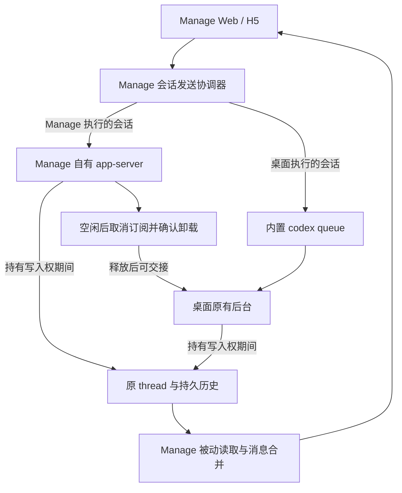

# 桌面后台复用与 Manage 会话锁释放方案（待审核）

- 日期：2026-11-03。
- 状态：**方案待审核，尚未实施产品改造。**
- 适用对象：本机官方 `/Applications/ChatGPT.app` 的本地 Work/Codex 会话；本次验证版本为桌面 `26.1002.52244`、内置 CLI `0.162.0-alpha.2`。
- 用户约束：官方桌面按原方式启动，保留原后台、原会话和原历史。Manage 负责适配；本轮只提交方案供审核。

## 1. 说明原因

**建议将两个改造一起实施：桌面持有会话时，Manage 通过桌面现有 `codex queue` 入口发送消息，由桌面原后台执行；Manage 持有会话时，在工作结束并确认空闲后自动释放写入权，供桌面继续原会话。**

本方案所说的“复用桌面服务”，具体指复用桌面后台的消息处理能力。Manage 可以从自己的界面向原会话发送消息，但目前只能通过已验证的投递入口实现。直接附着默认启动的桌面私有 app-server、获取其完整 RPC 与事件流，尚未建立可用入口。

| 问题 | 已确认事实 | 对方案的影响 |
| --- | --- | --- |
| 为什么以前能双端 resume，现在会占用 | 官方 CLI 升级引入单写入者限制，两个独立后台不能同时持有原 thread 的写入权 | 按会话选择执行入口，避免反复争抢 |
| 桌面保持正常启动，Manage 能否继续桌面原会话 | 本机内置 `codex queue` 已验证成功，空闲时续聊、执行时排队均保留原 ID 和上下文 | 将该投递路径接入 Manage |
| Manage 先处理，桌面是否也会冲突 | 已在官方桌面日志中复现原 ID 的 `already has an active writer` | Manage 也必须主动释放 |
| 回答结束是否已经释放 | 没有；当前只是改成等待输入 | 增加空闲取消订阅和卸载确认 |
| 是否可以只释放这一条会话 | 已验证 `thread/unsubscribe` 后释放该 thread，后台 PID 不变，其他会话继续工作 | 按 thread 释放，保留 Manage 后台 |
| 释放需要多久 | 默认约 60 秒；仅给 Manage 后台设置 1 秒卸载间隔的实验已通过 | 建议 Manage 专用参数设为 1 秒 |
| 桌面报错后是否自动恢复界面 | 尚未验证通过 | 必须补充原版桌面原会话交接验收，不能承诺自动重试 |

上述结论来自本机隔离实验，未使用用户真实会话或真实模型。`queue` 是本机预发布版本具备的原生能力，尚不能视为所有桌面版本都有的稳定公开接口。

## 2. 当前代码问题点

1. Manage 发送始终走自己的 `thread/resume` / `turn/start`，没有复用桌面原后台的发送路由；通用占用错误还直接把持有者写成 ChatGPT，实际也可能是其他 CLI。
2. `turn/completed` 后保留订阅，产品代码没有调用 `thread/unsubscribe`。创建或恢复后停在等待输入的会话也可能持续持锁。
3. 恢复和发送分段执行，新增释放后必须统一串行化，否则新输入可能撞上正在卸载的 thread，或被旧的 `waiting_input` 状态误导。
4. Manage 目前依靠自己后台的通知更新运行状态。桌面队列投递不会自动把桌面的完整事件流、审批和模型设置同步给 Manage。
5. 某些受控子用户读取路径会尝试恢复运行时；配置监听也会把桌面状态 JSON 的变化当成配置更新。它们都可能破坏“查看不争抢、空闲后释放”的目标。

## 3. 代码错误位置

以下为当前实现位置，用于界定改造范围；不是对所有相关代码的整体否定。

| 位置 | 当前行为与需补齐的能力 |
| --- | --- |
| `src/server/services/CodexAppServerClient.ts:93` | 启动 Manage 自有后台；增加仅作用于该进程的卸载间隔配置 |
| `src/server/services/RuntimeManager.ts:178`、`:366`、`:421` | 恢复与发送；接入按 thread 串行的获取、发送、释放流程 |
| `src/server/services/RuntimeManager.ts:797` | 回答完成后未安排空闲释放 |
| `src/server/services/RuntimeManager.ts:1004` | 已能将 `notLoaded` 映射为 `history`，继续复用；增加明确的释放状态，避免混淆 |
| `src/server/services/SessionService.ts:166` | 历史通过 `thread/read` 读取；复用为不取得写入权的观察入口，并验收分页长历史 |
| `src/server/routes/sessions.ts:272`、`:380`、`:874` | 运行态读取、发送及占用提示；加入能力判断、投递结果及明确的外部占用状态 |
| `src/server/services/CodexConfigWatcher.ts:130` | 过滤真实配置文件，排除桌面界面状态等运行数据 |
| `src/shared/models.ts:328`、`:361` | 补充执行入口、释放状态、投递状态和同步事件的协议字段 |

## 4. 修改方案

### 4.1 审核范围与预期体验

桌面保持默认图标启动方式，使用原有私有后台。Manage 增加两个能力：

- **桌面原会话续聊**：主用户在 Manage 输入文字，消息投递给桌面原会话；桌面继续处理，Manage 更新已保存的消息和回答。
- **Manage 自动让出写入权**：Manage 自己执行的会话在空闲后自动卸载该 thread；桌面随后可以尝试恢复原会话。

本期覆盖同一台机器上的 Manage 后端与桌面，使用相同的 `CODEX_HOME`。Web/H5 浏览器可以在其他设备，但执行 `queue` 和读取会话记录的 Manage 后端必须在桌面所在机器。普通 ChatGPT 云端聊天不在本地 thread 方案内。

| 能力 | 本期方案 |
| --- | --- |
| 原会话 ID、已有上下文 | 保留，不自动创建替代会话 |
| 桌面正在执行时从 Manage 追加文字 | 入队，当前轮结束后处理；不承诺立即 steer |
| Manage 读取桌面新增的用户消息和回答 | 增加被动同步，按原生消息 ID 合并 |
| 桌面侧逐 token、精确执行状态和工具事件 | 只有取得可靠记录才展示；本期不承诺完整实时事件流 |
| 桌面侧审批、中断、模型及权限切换 | 继续由桌面操作；Manage 根据实际能力显示入口 |
| Manage 自己执行时的现有审批、工具、中断能力 | 继续使用原有执行路径 |
| 受控子用户、附件、显式模型/权限覆盖走桌面队列 | 本期不接入；不能绕过现有控制规则或默默丢弃参数 |
| 默认桌面私有 app-server 的完整 RPC 共享 | 保留为独立研究项，不能作为本期依赖 |

此前 SRF-01 的外部共享服务、SRF-02 的桌面启动适配器实验继续保留，作为后续可选研究。它们涉及桌面启动入口的变化，与本期用户要求不同。**本期不需要桌面设置环境变量、4500 监听端口、CLI 替换或启动适配器。**

### 4.2 服务形态



图中两条执行路径遵守单写入者限制，不同时取得同一 thread 的写入权。Manage 的自有后台仍可服务其他会话；复用桌面执行时退出 Manage 只停止自己的观察与投递组件，不能停止桌面后台。

### 4.3 按会话选择发送入口

打开页面、刷新历史和读取运行态均不主动争抢写入权。只在用户明确执行发送、创建会话或其他需要写入的操作时获取相应能力。

| 当时状态 | Manage 的处理 |
| --- | --- |
| Manage 正持有该 thread 且未释放 | 使用现有执行入口，发送与释放进入同一串行队列 |
| Manage 正在释放 | 保存本次输入，待卸载确认后再决定恢复或投递；不能丢弃或重复发送 |
| 已确定使用桌面投递路径且本地条件满足 | 使用 `codex queue`，不反复对同一会话 resume |
| 当前未持有、归属未知，用户要求发送 | 尝试取得原 thread；成功则由 Manage 执行 |
| 获取原 thread 明确返回 active writer，且桌面投递条件满足 | 在尚未提交用户消息的前提下，切换为原生队列投递 |
| 持有者或桌面接收能力不明确 | 标记外部占用/能力未知，保留输入，给出可操作结果，不自动复制历史 |
| 消息可能已提交，但响应超时/进程退出 | 标记投递结果待确认，先查记录；不自动换另一条路径再发一次 |

`active writer` 只能证明存在其他写入者，不能证明持有者一定是桌面。检测到桌面进程、检测到 `queue` 命令，也不能单独证明指定 thread 有可消费的接收者。后台发现负责判断候选条件，投递后的实际消费需独立确认。

现有重试应区分短暂竞争和持续外部占用。已确定走桌面路径后，不再每次等待一轮盲目 resume 重试。

### 4.4 复用桌面后台发送消息

Manage 后端以参数数组执行桌面内置命令，保持相同数据目录：

```sh
/Applications/ChatGPT.app/Contents/Resources/codex-cli/bin/codex queue \
  --thread '原 thread ID' \
  --message '用户本次输入'
```

实现分成三个步骤：

1. **检查能力**：识别本机桌面安装位置和 CLI 版本，检查 `queue` 能力及本地数据目录，确认会话访问权限。执行探测不发送消息、不启动或重启桌面。当前安装版本是已验证基线；其他版本需通过同一兼容验收。
2. **记录并投递**：发送前保存 Manage 的 `clientRequestId` 与投递记录，调用原生命令；保存返回的原生 queue message ID、thread ID 和时间。
3. **观察消费**：命令成功退出只显示“已入队”；看到可靠会话记录后更新为已进入会话或已完成。消息关联方式必须验证，不能仅按文本相同判定，也不能把下一条任意回答当成这次消息的回答。

建议投递状态为“提交中、已入队、已进入会话、已完成、明确失败、结果待确认”。只有可靠证据表明在执行时才显示“执行中”。

同一 `clientRequestId` 的重复 HTTP 请求返回原投递记录，避免双击或网络重试重复调用 CLI。原生命令本身的幂等性尚未验证；若调用超时或在返回 ID 前崩溃，保留不确定状态并查证，不能承诺端到端严格一次执行。

桌面队列模式沿用桌面的模型、权限和审批。Manage 不能把本地配置伪装成已在桌面生效。用户携带附件、显式覆盖要求或受控子用户请求时，在发送前明确返回本期不支持，并保留输入。

### 4.5 消息与状态同步

通过 `SessionService` 的不取得写入权的读取路径获取原 thread 快照；按需扩展持久记录解析和增量索引。读取历史与状态刷新不能为了获取通知而调用 `resume`。现有 JsonlSessionParser 主要提供命令及模型信息，不能直接视为已实现完整消息观察器。

建议当前页面在等待桌面回复时约每 1 秒检查变化，空闲时降至约 5 秒；该周期是待实现参数，不是已验证的桌面响应延迟保证。按版本/文件变化合并读取，避免每次全量扫描历史。页面重连后先读快照，再补增量。

合并键使用原生 thread/turn/item ID；对于没有原生消息 ID 的记录，使用可稳定复现的记录位置等来源标识，并明确映射规则。不能以文本内容去重，同样一句话允许用户主动发送多次。

完成状态以可关联的 turn 完成记录为准。只看到正文更新、若干秒没有新数据、Manage 自有后台显示 `history`，都不能证明桌面执行结束。不能确定时显示“等待桌面处理/同步中”，并保留最近同步时间。

桌面审批、本机后台工具等状态在本期没有可靠读取证据时，提示到桌面查看，不显示虚假的可审批或可中断按钮。具体状态完整度、长历史分页及 queue message ID 的关联方式属于实施前必须补齐的验证门禁。

### 4.6 自动释放 Manage 的会话锁

**建议默认开启自动释放；只给 Manage 自有 app-server 传入 `-c thread_unload_delay_secs=1`，不写入共用的 `config.toml`。** 回答结束后确认空闲，立即安排取消订阅；通常再经过约 1 秒的后台卸载间隔。该时间是观测值和配置目标，不是固定 SLA。

释放前同时确认：

- 没有活动 turn、待审批、未完成工具、后台任务或仍在执行的子任务。
- 没有排队输入、模型设置、权限设置、压缩等未完成操作。
- Manage 仍持有该 thread 的运行时，且没有更新的操作代次。

若不能可靠确认后台任务已结束，本次不释放，给出阻塞原因。前端断开连接、切换标签页或关闭浏览器不能作为工作已经结束的证据。

流程：

1. 在同一 thread 的串行操作队列里复核空闲条件，标记“释放中”。所有获取、恢复、发送和释放共用顺序控制；重构时避免现有公开方法相互嵌套造成同一锁重入等待。
2. 调用 `thread/unsubscribe`。`unsubscribed` 仅表示订阅已撤销，不能立即显示“已释放”。`notSubscribed` 也不等于已经卸载。
3. 等待 `thread/closed` / `notLoaded`，必要时用 `thread/loaded/list` 校验该 thread 不再加载；确认后标记“已释放”，清理本次订阅与定时状态。
4. 新输入在取消订阅前到达，取消释放并正常发送；在取消订阅后到达，先完成卸载确认，再显式恢复原 thread 与订阅。不能使用过期的 `waiting_input` 缓存跳过恢复。
5. 如果恢复时桌面已先取得写入权，按 4.3 选择桌面投递路径，不再重建历史。

创建或恢复后没有输入、失败/中断后转为空闲的会话，也使用同一检查流程，避免只覆盖正常回答完成。新建后尚有待发送操作时不释放。应用重载、退出时停止相关计时器并保留既有活动任务保护；不能为清锁强杀桌面或重启整个后台。

超出确认期限仍未卸载时，显示“释放待确认”及原因，不伪报成功；检查是否有其他订阅者或后台工作。可提供仅对 Manage 自有且已空闲的会话执行的“释放占用”操作，仍走同一复核与确认流程。

### 4.7 双端使用时的实际表现

| 用户操作 | 实施后的预期 |
| --- | --- |
| 桌面先打开原会话，随后从 Manage 发文字 | 投递给桌面原后台，回答保存到原会话并同步到 Manage |
| 桌面正在回答，Manage 又发一条 | 明确显示已入队，按桌面队列语义继续 |
| Manage 先完成一轮，之后用户在桌面打开原会话 | Manage 自动释放后，桌面可尝试恢复原 ID；无需复制历史 |
| Manage 正在执行任务，用户同时在桌面恢复 | 单写入者限制仍存在；不为了立即交接而中断任务 |
| Manage 页面一直停在原会话 | 被动读取不重新取得锁，不因页面仍打开而无限占用 |
| 释放过程中用户从 Manage 再次发送 | 保留本次输入，按卸载/恢复顺序处理 |
| 桌面已报占用，随后 Manage 释放 | 后台可接管已证实；桌面能否自动重试尚待验收，必要时重新打开原会话 |
| 队列投递后桌面退出或长时间不消费 | 显示待处理/结果待确认；不自动复制会话或重复投递 |

对“Manage 先处理后桌面接管”，完整原版桌面 UI 的同一 thread 交接必须作为上线前验收门禁。当前已有的是释放后另一官方后台恢复相同 ID 并保留上下文的证据，尚不能代替该 UI 验收。

### 4.8 能力开关、兼容与回退

桌面投递与 Manage 自动释放分别设置功能开关，便于独立回退。显示当前 CLI 版本、queue 能力、执行入口及释放状态，避免把环境不支持误判成用户会话损坏。

不支持卸载配置或取消订阅接口的版本不能静默宣称自动释放有效；保留原有执行方式并明确能力受限。升级兼容验证不能通过时，关闭新路径；不自动降级用户 CLI，不调整桌面配置，不删除会话文件或修改底层锁数据。

投递台账放在 Manage 自己的数据存储中，排除在 Codex 配置监听之外。配置监听仅关注真实生效配置，避免桌面写 `.codex-global-state.json` 引发 Manage 重载或反复恢复会话。

### 4.9 验收标准

下表是待实施改造的验收要求；已有原生实验通过，不代表产品集成已经通过。

| 验收项 | 通过条件 |
| --- | --- |
| 桌面保持现状 | 默认启动，后台 PID 保留；安装包、环境配置、监听端口均无需改变 |
| 桌面空闲时续聊 | Manage 发送进入原 ID，回答含已有上下文，桌面与 Manage 均可见 |
| 桌面运行时续聊 | 后续消息入队并有序消费，不丢失、不自动 steer |
| Manage 接收桌面主动输入 | 已保存的新用户消息和回答自动补入，无重复消息 |
| 不争抢查看 | 打开页面、切换会话、历史与运行态轮询不 resume、不导致写入占用 |
| Manage 完成后释放 | 空闲条件满足后取消订阅，收到卸载确认，原 thread 从加载列表移除 |
| 原版桌面接管原会话 | Manage 后台仍存活，桌面恢复相同 ID 并继续，模型输入保留原上下文 |
| 桌面已经显示占用后的恢复 | 分别验收自动重试和重新打开原会话；按真实结果形成用户提示 |
| 多会话互不影响 | 释放 A 时，B 仍执行、审批、接收输出，后台 PID 不变 |
| 任务保护 | 审批、工具、后台终端、子任务、压缩及设置未完成时均不误释放；状态不明时不释放 |
| 新输入与释放竞争 | 覆盖取消订阅前、后及卸载通知到达时，消息均不丢失、不重复 |
| 重复投递和不确定失败 | HTTP 重试复用投递记录；CLI 超时/崩溃不盲目重发，不把已入队当已完成 |
| 状态与消息关联 | 相同文本的两次主动发送均保留，其他端并发输入不会被当作本次消息的完成 |
| 能力边界 | 子用户、附件、模型/权限覆盖不绕过校验；队列模式不显示不可用的审批/中断操作 |
| 生命周期与兼容 | Manage 刷新/退出不停止桌面；桌面退出、未加载目标 thread、不同目录、CLI 升级均有明确结果 |
| 长历史与重连 | 分页历史、页面重连及增量读取不缺消息，不通过恢复运行时取历史 |
| 配置变化 | 桌面界面状态与投递台账更新不触发 Manage 后台重载；真实配置更新保持既有保护 |

先沿用隔离目录和模拟模型跑原版桌面与实际 Manage UI；补齐真实工程工具任务验证后再进入发布验收，不能仅凭模拟文本推断工具副作用不会重复。

### 4.10 实施顺序

1. 补齐 queue 消息关联、目标未加载时的消费行为、后台任务空闲判定、原版桌面原 ID 接管四个验证缺口；将结果写入协议与能力约定。
2. 实现 Manage 自有会话释放、卸载确认与新输入竞争处理，加入有意义的状态机与多会话回归。
3. 实现桌面原生投递、投递台账、被动读取及界面能力限制，复用已有会话访问校验。
4. 将两部分接入同一会话发送协调器，完成上述端到端验收和独立开关回退。

验证缺口导致某个能力不能成立时，先修订方案及验收结果；不通过增加默认历史复制或改桌面启动方式掩盖问题。

## 5. 修改的代码点

以下均为**计划改造**，本轮没有修改产品代码。

| 组件 | 计划修改 |
| --- | --- |
| 新增会话发送协调器（建议 `SessionExecutionCoordinator`） | 按 thread 统一恢复、发送、投递和释放顺序；仅在明确未提交时切换路径 |
| 新增桌面消息投递组件（建议 `DesktopQueueService`） | 安装位置/能力检测、原生命令参数调用、超时分类及投递结果解析 |
| 新增投递台账 | 保存 clientRequestId、原生队列 ID、状态与查证信息；支持 Manage 重启后对账 |
| `RuntimeManager.ts` | 空闲判定、取消订阅、卸载确认、显式恢复订阅、计时器和操作代次管理 |
| `CodexAppServerClient.ts` | Manage 自有后台的进程级卸载配置及兼容诊断 |
| `SessionService.ts` / 被动观察组件 | 非占用快照、增量读取、消息合并与有限状态同步；补足现有 parser 的能力 |
| `routes/sessions.ts` | 发送/恢复/读取路由接入协调器；主动释放入口、幂等请求及能力错误；保证受控子用户边界 |
| `AppRuntime.ts` / `CodexConfigWatcher.ts` | 装配新组件、重载保护、停止观察器；缩小配置监听范围 |
| `shared/models.ts` 与会话前端 | 增加执行入口、释放状态和投递状态；保留草稿，展示已入队与同步结果，按能力提供操作 |
| 相应服务测试与桌面/Manage E2E | 覆盖状态转换、消息唯一性、交接、故障及已有功能回归 |

### 本次请审核的取舍

1. **采用桌面现有 queue 入口复用原后台**；完整私有 app-server 附着继续作为独立研究。
2. **Manage 默认在空闲后自动释放**，后台卸载间隔建议设为 1 秒，仅影响 Manage 自己启动的进程。
3. **本期桌面路径先覆盖主用户文字续聊与持久消息同步**；审批、中断、模型/权限及附件等仍按能力限制处理。
4. **保留原 thread，不自动改为复制历史的新会话**；无法确认消费或释放时明确显示待确认，并保留用户输入。

审核后按确认的范围实施；本方案不表示已完成产品接入或已通过完整双端交接验收。

### 依据与证据

- [桌面原生续聊验证：8 项通过](2026-11-03-desktop-native-continuation.md)，[机器可读结果](../acceptance/2026-11-03-desktop-native-continuation/results.json)。
- [Manage 写入权释放验证](2026-11-03-manage-writer-release.md)，[后台交接：6 项通过](../acceptance/2026-11-03-manage-writer-release/backend-handoff-results.json)，[原版桌面冲突与默认 60 秒卸载复核](../acceptance/2026-11-03-manage-writer-release/stock-desktop-review.json)。
- [Git 与 CLI 升级根因](2026-11-03-writer-lock-upgrade-history.md)。
- [SRF-01 外部共享服务](2026-10-30-shared-runtime-feasibility.md)、[SRF-02 桌面创建共享后台](2026-11-03-desktop-owned-runtime-feasibility.md)：保留原实验边界，不作为桌面零修改路径的已交付能力。
- 官方 OpenAI Docs：[Codex App Server](https://developers.openai.com/codex/app-server)，支持取消订阅、最后订阅者、默认卸载间隔及卸载通知的语义；本机 `queue` 可行性来自安装版本实测。
